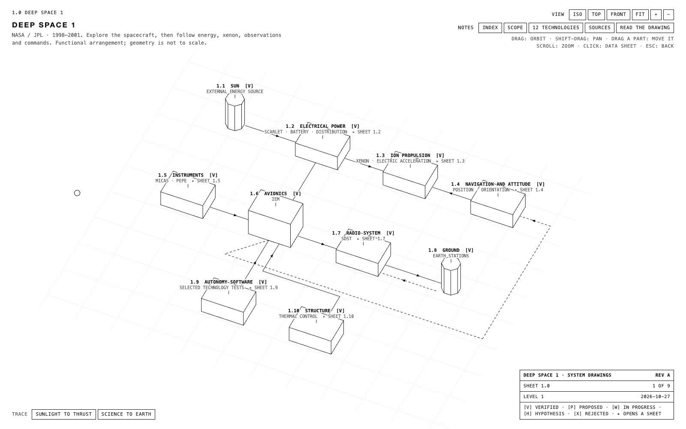

# system-drawings

A skill that lets any coding agent turn a system into an **explorable set of three-dimensional technical drawings**, in the manner of 1970s IBM and NASA documentation: a white sheet, black line-drawn solids, uppercase lettering, reference designators and a title block.

Readers do not scroll through a page. They:

- **see the whole system first:** every component and how the components talk;
- **orbit, zoom and drag parts around** to understand the arrangement;
- **click a part** for its data sheet (function, rationale, parameters, sources);
- **open a subsystem** into its own sheet, like going from the car to the engine to one cylinder;
- **trace a request** step by step as a marker travels the connections and a caption explains each step.

The output is one self-contained HTML file with no dependencies.

## Examples

| Example | Sheets | Shows |
|---|---|---|
| [`examples/automobile`](skills/system-drawings/examples/automobile/) | 3 | Car → engine → one cylinder; traces for accelerating, starting, valve timing, and the four strokes |
| [`examples/causal-delta`](skills/system-drawings/examples/causal-delta/) | 9 | A research system for repairing regressions in fine-tuned models: a 52-plate decoder stack, live adapter dials, a concept figure, 11 traces |
| [`examples/deep-space-1`](skills/system-drawings/examples/deep-space-1/) | 9 | NASA's Deep Space 1: 78 components, 14 traces, spacecraft → ion propulsion → NSTAR mechanism, with NASA/JPL references |

Open any example's `index.html` directly in a browser.

### Deep Space 1 demonstration

[](https://github.com/3xC1ibR/system-drawings/raw/refs/heads/main/skills/system-drawings/examples/deep-space-1/demo/deep_space_1_demo.mp4)

[Watch the 38-second video](https://github.com/3xC1ibR/system-drawings/raw/refs/heads/main/skills/system-drawings/examples/deep-space-1/demo/deep_space_1_demo.mp4) (MP4, 5.4 MB, silent). It demonstrates orbit controls, subsystem navigation, the ion-acceleration trace and a sourced component data sheet. The [example guide](skills/system-drawings/examples/deep-space-1/) explains the sources and schematic limitations.

## How it works

The agent writes content (`drawing.json`: sheets, parts, links, traces). The bundled engine renders it. Scripts keep the result honest:

```bash
S=skills/system-drawings
python3 $S/scripts/validate_drawing.py drawing.json                       # structure, sheet tree, spacing
python3 $S/scripts/build_drawing.py drawing.json -o out/index.html        # single self-contained file
python3 $S/scripts/inspect_drawing.py out/index.html --out out/inspection # headless Chrome screenshots + layout audit
```

The full method is in [`skills/system-drawings/SKILL.md`](skills/system-drawings/SKILL.md). Its references cover the [design principles](skills/system-drawings/references/design-principles.md), the [content schema](skills/system-drawings/references/content-schema.md), [layout rules](skills/system-drawings/references/layout-rules.md) and [verification](skills/system-drawings/references/verification.md).

## Install

**Agents that read `~/.agents/skills`:**

```bash
git clone git@github.com:3xC1ibR/system-drawings.git
ln -s "$PWD/system-drawings/skills/system-drawings" ~/.agents/skills/system-drawings
```

**Claude Code:** add this repository as a plugin marketplace (`.claude-plugin/marketplace.json`), or symlink the skill directory into `~/.claude/skills/`.

**Codex:** the plugin manifest is `.codex-plugin/plugin.json`.

Requirements: Python 3.9+ (standard library only). `inspect_drawing.py` needs Chrome or Chromium; set `CHROME_PATH` if it is not found automatically.

## Tests

```bash
python3 tests/run_tests.py            # validation, build determinism, stale-example and negative checks
python3 tests/run_tests.py --render   # also renders every example in headless Chrome
```

## License

MIT
